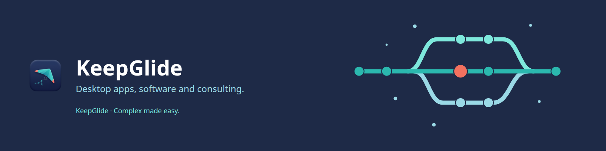

# KeepGlide

 [-green.svg)](README.pt-BR.md)

We build desktop apps and software solutions, and offer technology consulting. **Complex made easy.**

[Products](#-products) · [Consulting](#-consulting) · [Contact](mailto:hello@keepglide.com) · [keepglide.com](https://keepglide.com)

## 🧩 Products

| Product | What it is | Status | Link |
|---|---|---|---|
| KeepGlide app | The desktop app for Windows, macOS and Linux. Notes, PDFs and files in one place. | Coming soon | [keepglide.com/get](https://keepglide.com/get) |
| Askaway | A Claude Code mod that turns the questions your sessions ask into one clear inbox. | Public beta (`0.4.2`) | [KeepGlide/askaway](https://github.com/KeepGlide/askaway) · [keepglide.com/askaway](https://keepglide.com/askaway) |
| master-jev-hook | Hooks and MCP that make Claude Code, Claude Desktop and Codex delegate decisions to TypeSafe JEV through a local gateway. | Early access beta (`1.3.0-beta.2`) | [KeepGlide/master-jev-hook](https://github.com/KeepGlide/master-jev-hook) · [keepglide.com/products](https://keepglide.com/products) |
| KeepTrack | A Claude Code Desktop pane and band that track the GitHub repo of your session: sessions, issues, milestones and whether work is running. | Coming soon | — |
| Agent Atlas | A desktop app that maps the Claude Code agents, skills and commands of your repositories, and shows the story of their changes. | Private beta (`3.1.0`) | — |
| Claude plugins | KeepGlide's Claude Code plugin marketplace: one catalog for every KeepGlide plugin. | Public | [KeepGlide/claude-plugins](https://github.com/KeepGlide/claude-plugins) · [keepglide.com/products](https://keepglide.com/products) |

Private products are named without a link.

## 💼 Consulting

Custom software, AI automation and technical advisory. Reach us at [hello@keepglide.com](mailto:hello@keepglide.com).
